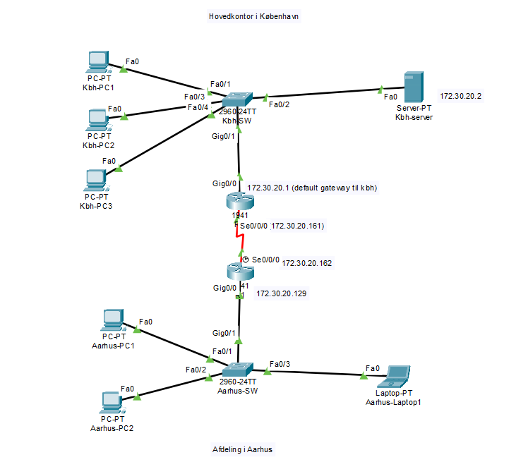
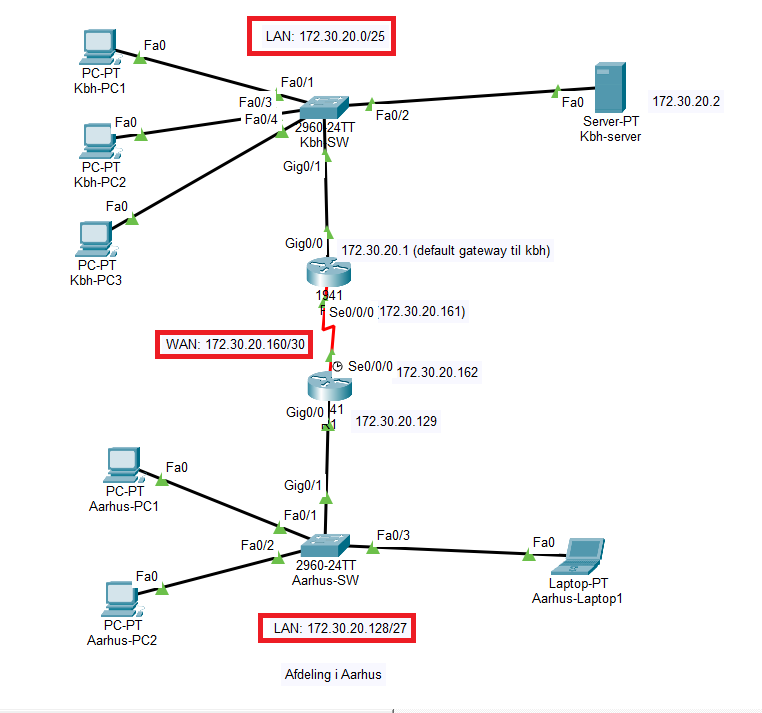

# Network Topology Evidence

This folder contains network diagrams from the CMIS infrastructure team project.

## Network Topology

**`cmis-network-topology.png`**

Shows the overall network design and the connections between network components and sites.

## LAN/WAN Subnets

**`cmis-lan-wan-subnets.png`**

Shows the LAN/WAN subnet layout used in the network design.

