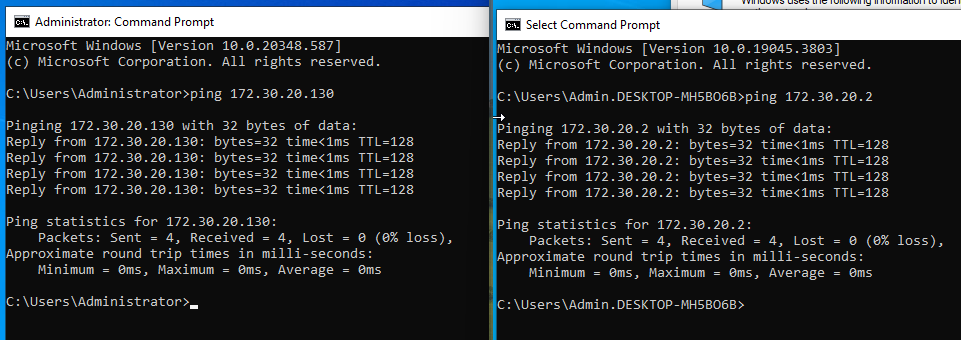

# Network and Group Policy Testing

This folder contains evidence of connectivity testing and Group Policy verification completed as part of the CMIS team project.

## 1. Ping Connectivity Test

Shows successful ping replies and 0% packet loss, demonstrating connectivity between the tested endpoints.

## 2. Group Policy Applied to Client

Shows evidence of Group Policy application on a client PC.

## 3. Group Policy Applied to User

Shows evidence of Group Policy application for a user account.

## Purpose

These screenshots support the team's verification of network connectivity and domain policy configuration.
