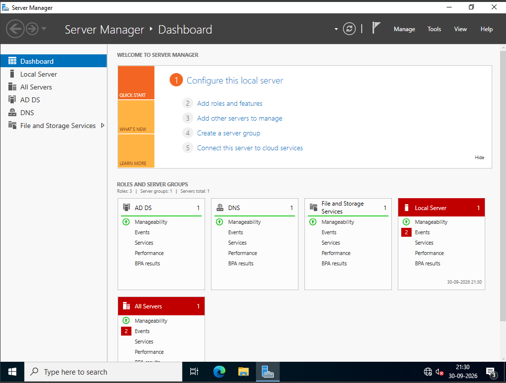
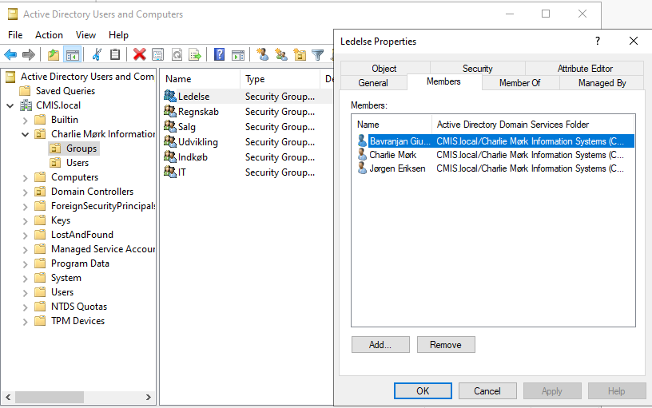
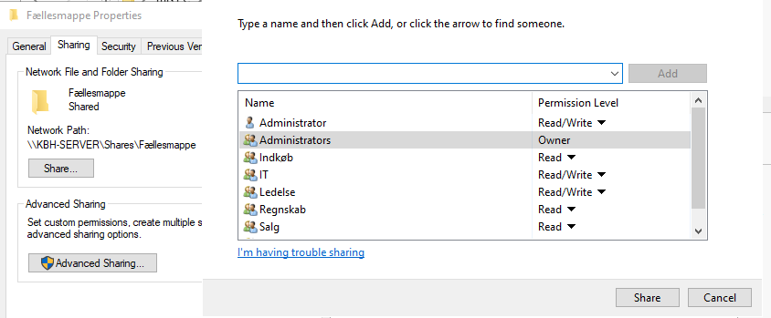
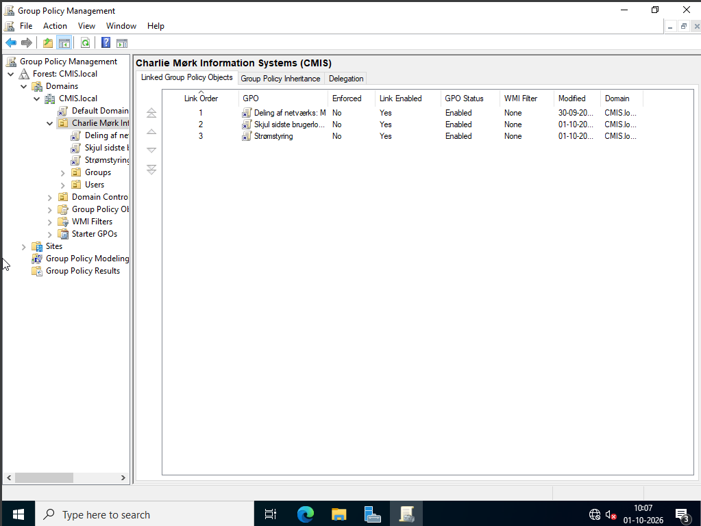

# Windows Server Configuration Evidence

This folder contains screenshots documenting Windows Server configuration completed as part of the CMIS team project.

## 1. Server Manager

Shows the Windows Server management dashboard used to manage server roles and features.

## 2. Active Directory Users and Groups

Demonstrates user and group administration in Active Directory.

## 3. Shared-Folder Permissions

Shows the configuration of permissions for shared resources.

## 4. Group Policy Management

Shows the Group Policy Management interface used to configure and manage domain policies.
