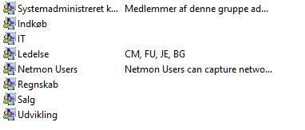

# Enterprise Active Directory & Group Policy Deployment

This project documents a Windows Server lab covering domain configuration, centralized identity management and Group Policy enforcement.

## Technologies
- Windows Server 2022
- Active Directory Domain Services
- DNS and DHCP
- Group Policy Management
- VirtualBox

## Configuration and Verification
The project evidence includes domain configuration, client domain membership, organizational units, Group Policy settings and network diagnostics.

The screenshots below document the lab configuration and verification steps, including network settings, domain membership, Active Directory administration, and Group Policy enforcement.

## Key Tasks Completed

- Configured static IP addressing for the Windows Server lab.
- Configured DHCP and reviewed network settings.
- Set up an Active Directory domain environment.
- Created and managed Active Directory users and groups.
- Joined a client workstation to the domain.
- Created and managed Group Policy settings.
- Applied and verified Group Policy settings on the client workstation.
- Performed network diagnostics using ping and DNS lookup tools.

## Screenshots

### Network and Domain Configuration

### Active Directory

### Group Policy

