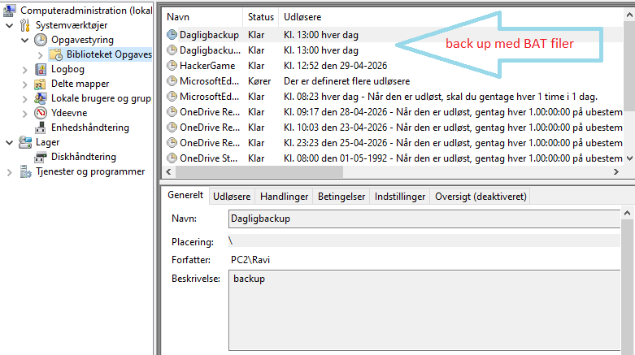
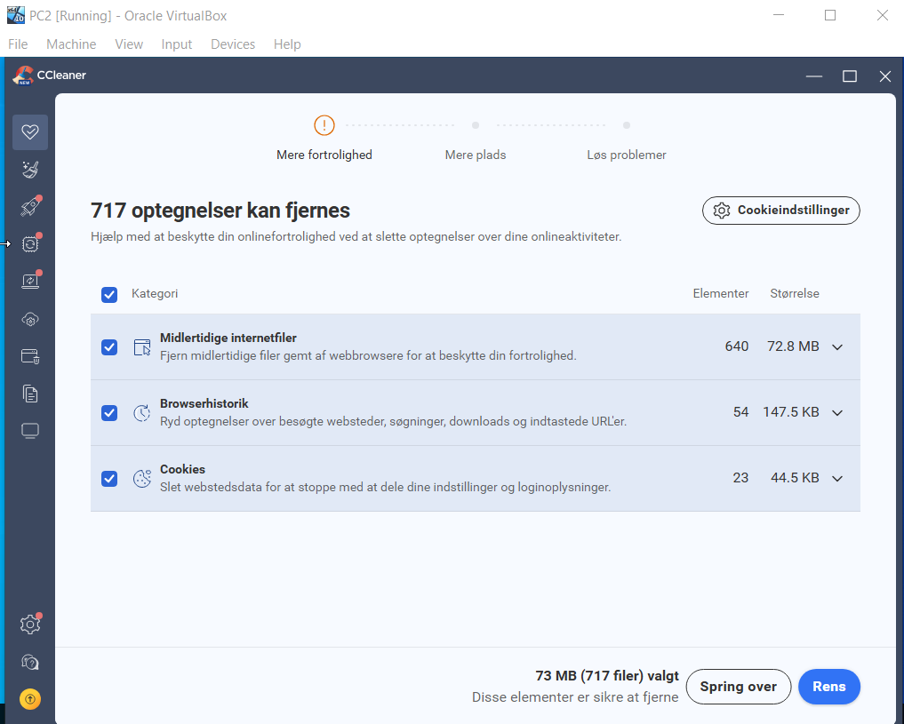
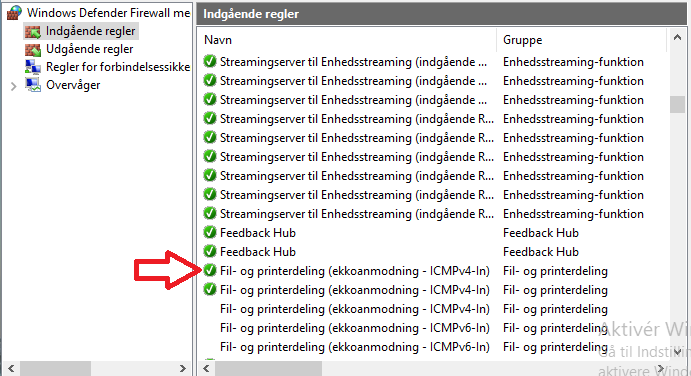
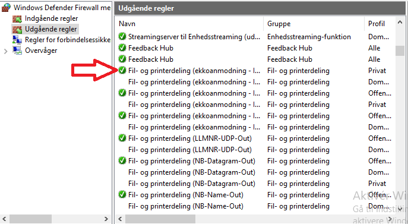
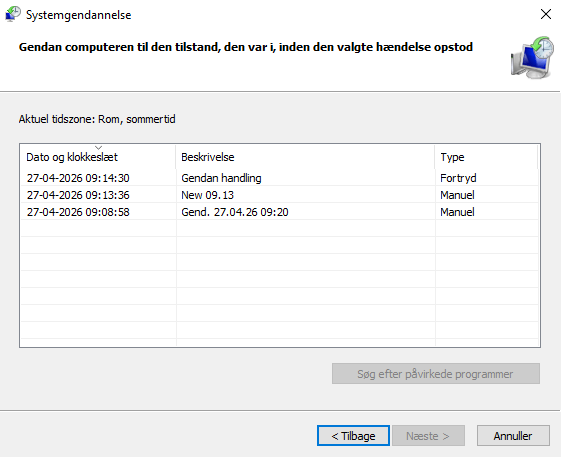

# Project 3: Workstation Security Hardening & Disaster Recovery

## Project Overview

This project documents workstation security, maintenance, backup and recovery activities in a virtualized Windows environment.

## Technologies
- Windows Task Scheduler
- Windows Defender Firewall
- AOMEI Backupper Standard
- Avast Antivirus
- Windows System Restore

## Implementation and Testing

The project evidence covers:
- Automated backup tasks
- Workstation antivirus protection
- Firewall inbound and outbound rules
- System Restore and recovery procedures
- Network troubleshooting, including APIPA addressing

The screenshots below document workstation security, backup and maintenance activities, firewall configuration, and system recovery procedures performed in a virtualized Windows environment.

## Key Tasks Completed

- Configured an automated backup task using a batch file and Windows Task Scheduler.
- Reviewed backup configuration using AOMEI Backupper Standard.
- Reviewed workstation antivirus protection.
- Configured and reviewed inbound and outbound Windows Firewall rules.
- Practised System Restore and recovery procedures.
- Investigated network connectivity issues, including APIPA addressing.
- Performed workstation maintenance and storage cleanup using CCleaner.

## Screenshots

### Backup and Maintenance

### Endpoint Security

### System Recovery

