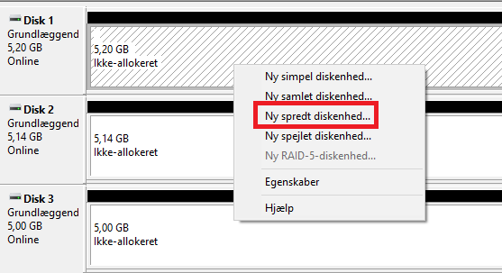
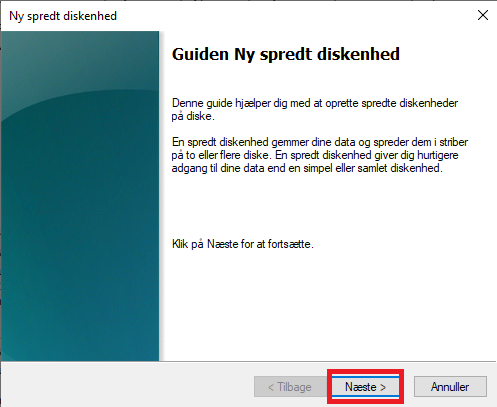
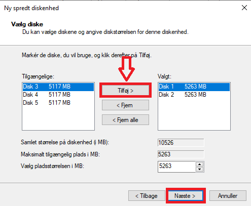
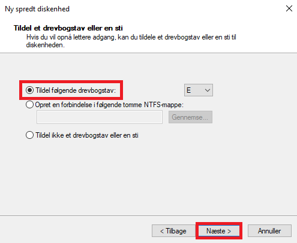

# Windows Disk Management Lab

## Project Overview

This lab documents Windows disk and volume management exercises using screenshots from the practical work.

## Evidence

The repository includes screenshots of spanned and striped volume configurations.

## Technical Skills
- Windows disk management
- Volume configuration
- Storage administration

## Screenshots

### Spanned Volume

### Striped Volumes

