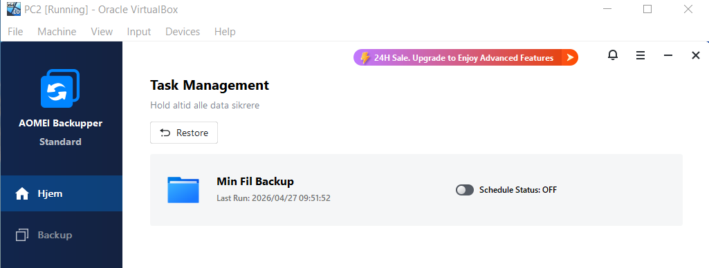
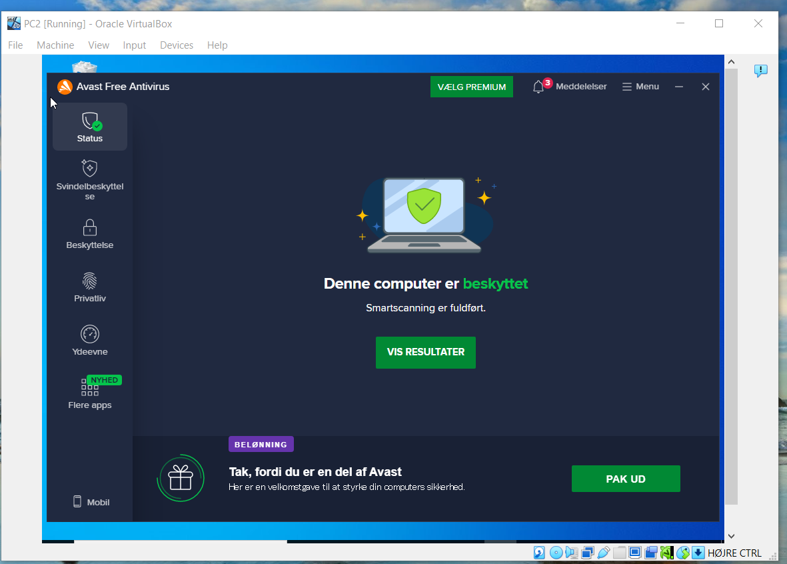
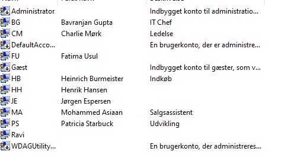
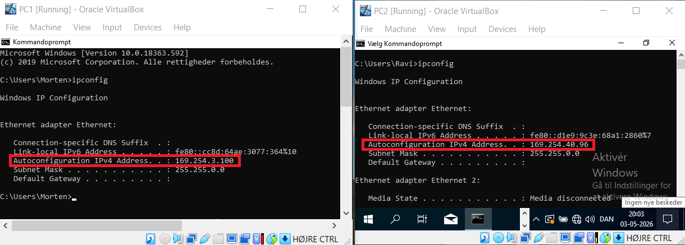
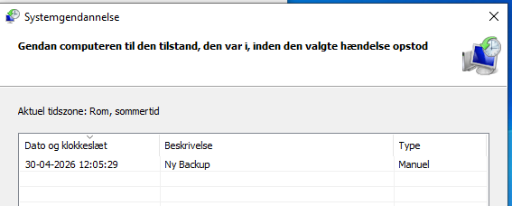

# 🧑‍💻 IT Support & Infrastructure Portfolio

**Aspiring IT Support / Helpdesk Professional**  
📍 Copenhagen, Denmark | 🎓 Technical Education Copenhagen (TEC)

Welcome to my IT portfolio. This repository documents practical projects and lab exercises in Windows Server administration, networking, endpoint security, and IT troubleshooting.

## 🛠️ Technical Skills

| Area | Technologies and Skills |
|---|---|
| Operating Systems | Windows Server 2022, Windows 10 Pro |
| Networking | IP addressing, subnetting, DHCP, DNS, routing, ping, traceroute |
| System Administration | Active Directory, domain users and groups, Group Policy |
| Security & Recovery | Windows Firewall, antivirus, backup, System Restore |
| Tools | Cisco Packet Tracer, VirtualBox, Task Scheduler, AOMEI Backupper |

## 📂 Featured Projects

### 01. CMIS — Network & IT Infrastructure

**Team members:** Ramakant Joshi and Jonas Larsen  
**Project type:** Collaborative team project

A team project focused on designing and implementing an IT infrastructure for a company expanding from Copenhagen to Aarhus.

**Key areas:**
- Network topology and VLSM subnetting
- DHCP, routing and inter-network connectivity
- Windows Server 2022 and Active Directory
- DNS, users, groups, file shares and permissions
- Group Policy, security and connectivity testing

📁 **[View CMIS Project Documentation](01-CMIS-Network-Infrastructure/)**

*The project documentation and supporting evidence will be added as the repository develops.*

### 02. Enterprise Active Directory & Group Policy

A Windows Server lab demonstrating domain setup, centralized identity management and workstation policy enforcement.

- Active Directory Domain Services and domain configuration
- DNS and DHCP
- Organizational units, users and groups
- Group Policy deployment and client verification
- Network connectivity diagnostics

[View Project 2 details below](#project-1-enterprise-active-directory-group-policy-deployment)

### 03. Workstation Security & Disaster Recovery

A workstation administration lab focused on endpoint protection, automated backup and recovery.

- Scheduled backup tasks and AOMEI Backupper
- Antivirus and workstation maintenance
- Windows Firewall rules
- System Restore and recovery procedures
- DHCP and network troubleshooting

[View Project 3 details below](#project-2-workstation-security-hardening-disaster-recovery)

## 📑 Project Documentation

Each project will include its own relevant documentation, configuration screenshots and testing evidence.

Project reports and supporting files will be organized by project to make the portfolio easy to navigate.


## 🛠️ Project 2: Enterprise Active Directory & Group Policy Deployment

### 📋 Project Overview
* **Objective:** Design, deploy, and secure a centralized Windows Domain environment using VirtualBox to simulate a corporate infrastructure.
* **Core Technologies:** Windows Server 2022 Standard, Active Directory Domain Services (AD DS), DNS, DHCP, and Group Policy Management.
* **Environment Parameters:** Domain: `firma.local` | DC Hostname: `SRV-01` | Network: `192.168.1.0/24`

### ⚙️ Implementation Details
1. **Network Baseline:** Configured Domain Controller with a static IP (`192.168.1.10`). Configured workstation `PC1` to use the server as its preferred DNS to successfully bind the client to the `firma.local` tree.
2. **Directory Identity Structure:** Deployed Active Directory Domain Services. Built a dedicated Organizational Unit (OU) named `Elever` to segregate restricted user profiles from core staff.
3. **Security Hardening (GPO):** Created and enforced a Group Policy Object (GPO) titled `Disable control panel`. Tied this rule to the `Elever` OU to restrict access to the control panel subsystem.

### 🔍 Verification & Diagnostics
* **Network Connectivity:** Executed bidirectional `ping` sweeps between host and guest environments to verify Layer 3 connectivity.
* **Service Availability Check:** Validated that crucial authentication and name resolution ports were online using command line telnet mapping:
  ```cmd
  telnet firma.local 53
  ```

<details>
<summary><b>📸 Click here to view Project 1 Screenshots & Configuration Proofs</b></summary>

| Static IP Configuration | Domain Name Details |
| :---: | :---: |
|  |  |

| Client Domain Association | GPO Management View |
| :---: | :---: |
|  |  |

| GPO Status Verification | GPO Deployment on Client |
| :---: | :---: |
|  |  |

| Network Diagnostics View | GPO Block Execution Proof |
| :---: | :---: |
|  |  |

</details>

---

## 🛠️ Project 3: Workstation Security Hardening & Disaster Recovery

### 📋 Project Overview
* **Objective:** Configure, secure, and automate maintenance workflows for corporate Windows workstations within a virtualized enterprise staging environment.
* **Core Technologies:** Windows Task Scheduler (Opgavestyring), Windows Defender Firewall, AOMEI Backupper Standard, Avast Antivirus, Windows System Restore (Systemgendannelse).

### ⚙️ Implementation & Maintenance Details
1. **Automated Data Redundancy:** 
   * Engineered automated daily backup routines (`Dagligbackup`) using **Task Scheduler (Opgavestyring)** to trigger localized file extraction processes automatically at 13:00.
   * Deployed **AOMEI Backupper Standard** to manage system-state partition images (`Min Fil Backup`), establishing robust backup histories.
2. **Workstation Optimization & Threat Mitigation:**
   * Installed **Avast Free Antivirus** to secure the local endpoints, ensuring full real-time file shielding and registry monitoring.
3. **Identity & Firewall Architecture:**
   * Structured local user security profiles based on department routing (e.g., `Bavranjan Gupta - IT Chef`, `Charlie Mørk - Ledelse`, `Mohammed Asiaan - Salgsassistent`).
   * Configured explicit **Windows Defender Firewall** inbound and outbound rules, enabling ICMPv4 protocols to support secure internal network diagnostics.

### 🔍 Technical Troubleshooting Case Study: APIPA Resolution
* **The Issue:** Workstations `PC1` and `PC2` suddenly experienced total loss of network resource accessibility.
* **The Diagnosis:** Detected a fallback IP allocation within the **`169.254.X.X` subnet range** via `ipconfig`. This directly isolated the root cause: an **APIPA (Automatic Private IP Addressing)** state, proving the clients completely lost operational links to the DHCP server.
* **The Recovery:** Leveraged **System Restore (Systemgendannelse)** points (`Ny Backup`) to roll back broken configuration boundaries, safely restoring workstation connectivity.

<details>
<summary><b>📸 Click here to view Project 2 Screenshots & Configuration Proofs</b></summary>

| Task Scheduler (Opgavestyring) | AOMEI Backup Deployment |
| :---: | :---: |
|  |  |

| Endpoint Protection | Local User Directories |
| :---: | :---: |
|  |  |

| CCleaner Storage Cleanup | APIPA Network Diagnostic |
| :---: | :---: |
|  |  |

| Inbound Firewall Rules | Outbound Firewall Rules |
| :---: | :---: |
|  |  |

| System Restore Baseline | System Restore Execution |
| :---: | :---: |
|  |  |

</details>

